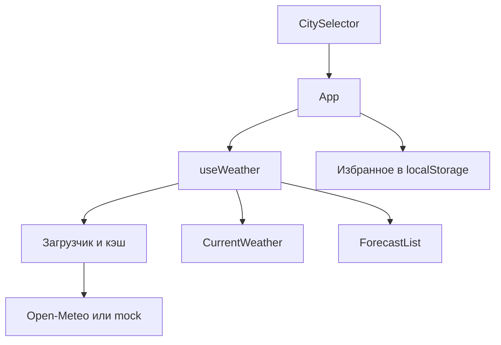

# Практическая работа №16 — Погодный менеджер

Продолжение №15 с избранными городами, кэшем и обработкой временных ошибок. Запускайте из полной копии репозитория.

```sh
npm install
npm test
npm run dev
npm run build
npm run preview
```

## Архитектура



Список городов и демопрогноз берутся из dataset №16. Как и в №15, API отдаёт текущую температуру, код погоды и ветер, а также даты, коды, минимумы и максимумы на три дня. Подписи и поля API используются из №15.

Кэш хранится в памяти 5 минут по паре «город, режим». Кнопка «Обновить» обходит TTL. Ошибка оставляет последний прогноз выбранного города в том же режиме с предупреждением об устаревании. При смене города запрос отменяется, а его опоздавший ответ игнорируется. Избранное сохраняется в localStorage.

## Проверки по dataset

| Сценарий | Результат автоматизированной проверки |
|---|---|
| select_city | Получены три дня прогноза |
| api_error | Есть сообщение, последний прогноз сохранён и помечен устаревшим |
| favorite_add | Город считывается после записи |
| unknown_weather_code | Показана резервная подпись |
| fresh, 30 с | Повторного запроса нет |
| expired, 600 с | Выполняется новый запрос |
| manual_refresh, 30 с | Выполняется принудительный запрос |

Для проверки в preview добавьте город в избранное, перезагрузите страницу и выберите город снова. В Network последовательно выберите два города, вернитесь к первому, нажмите «Обновить» и проверьте число запросов. Проверьте деморежим и Console. [Чек-лист сдачи](docs/quality_checklist.csv).
